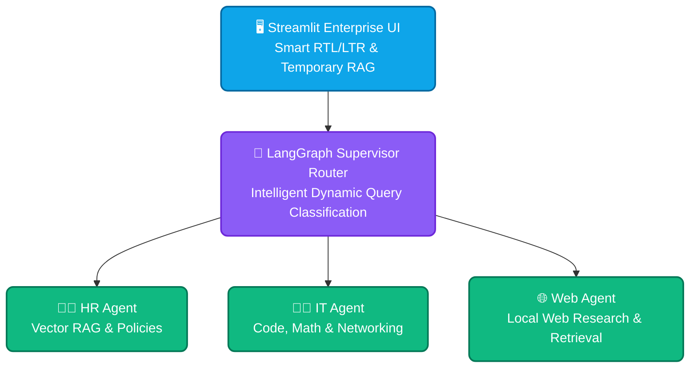

# 🏢 Enterprise Multi-Agent AI System

An advanced, production-ready, local-first multi-agent enterprise framework built with LangGraph (Supervisor + Specialized Agents), Streamlit, ChromaDB, and Ollama. Designed for absolute data sovereignty, air-gapped deployments, and enterprise-grade automation.

---

## Table of Contents

- [Overview](#overview)
- [Architecture](#architecture)
- [Key Components](#key-components)
- [Design Principles](#design-principles)
- [Quick Start](#quick-start)
- [Deployment Options](#deployment-options)
- [Configuration & Environment Variables](#configuration--environment-variables)
- [Adding New Agents](#adding-new-agents)
- [Operational Guidance (Scaling, Monitoring, Backup)](#operational-guidance-scaling-monitoring-backup)
- [Security & Data Sovereignty](#security--data-sovereignty)
- [Testing & Validation](#testing--validation)
- [Troubleshooting & FAQ](#troubleshooting--faq)
- [Contributing](#contributing)
- [License & Contact](#license--contact)

---

## Overview

This repository implements an on-premise, multi-agent orchestration platform for enterprise use cases. The system is intentionally "local-first": all document ingestion, vectorization, embeddings, and model inference run within your infrastructure. It is intended for organizations that require strong data sovereignty, deterministic behavior, and the option to run in air-gapped networks.

Use cases include: internal knowledge assistants (HR, IT, Legal), policy and compliance question answering, internal research automation, and developer-facing code assistants.

---

## Architecture

This system centers around a lightweight Streamlit-based UI and a LangGraph Supervisor that routes user requests to specialized agents. All agents can access a shared, local vector store (ChromaDB) and local LLMs via Ollama.



Key flow:
- Streamlit UI receives user requests and session context.
- The Supervisor classifies intents and routes to an agent.
- Agents may invoke local tools (search vector DB, code execution sandboxes, policy checkers).
- Responses are returned to the user with provenance metadata and optional citations.

---

## Key Components

- src/agents/: Agent implementations (HR, IT, Web, Supervisor router).
- src/tools/: Domain-specific tools exposed to agents using LangChain-style tool wrappers.
- src/database/: Local vector store integrations, index management, and persistence utilities.
- src/app.py: Streamlit frontend and session orchestration.
- requirements.txt: Python dependencies.

---

## Design Principles

- Local-first and air-gapped ready: No external API calls by default.
- Modular multi-agent design: Agents are isolated, testable, and replaceable.
- Reproducible environment: Use virtualenv, Docker, and deterministic dependency management.
- Security-first: Secrets and databases are stored locally with strict file-system permissions and optional encryption at rest.
- Observability: Structured logs, metrics, and simple health checks for production readiness.

---

## Quick Start

These instructions get you running a functional development instance on a single machine.

1. Clone the repository

```bash
git clone https://github.com/Moayadai/enterprise-multi-agent.git
cd enterprise-multi-agent
```

2. Create and activate a virtual environment

```bash
python3 -m venv .venv
source .venv/bin/activate
pip install -r requirements.txt
```

3. Configure environment variables

Copy `.env.example` to `.env` and edit values:

```env
OLLAMA_BASE_URL=http://localhost:11434
CHROMA_DB_PATH=./chroma_db_storage
LOG_LEVEL=info
```

4. Start Ollama (local LLM host) and pull required models

```bash
# start an Ollama container/process and run a model
ollama run llama3.1 --detach
ollama pull nomic-embed-text
```

5. Initialize or migrate the local vector store (Chroma)

```bash
python -m src.database.initialize
```

6. Launch the Streamlit UI

```bash
streamlit run src/app.py
```

Open the URL printed by Streamlit (usually http://localhost:8501).

---

## Deployment Options

1. Single-node development: Use virtualenv and local Ollama + ChromaDB.
2. Containerized (recommended for staging/production): Use Docker Compose to run Ollama, service app, and (optionally) a process manager. Keep services on an isolated network for air-gapped deployments.
3. Orchestrated (Kubernetes): Package the app as a container, mount persistent volumes for Chroma and any local model data, and use a StatefulSet for persistent storage. Restrict egress via network policies.

Example (docker-compose.yml) — high level:

```yaml
version: '3.8'
services:
  app:
    image: your-registry/enterprise-multi-agent:latest
    ports:
      - "8501:8501"
    volumes:
      - ./chroma_db_storage:/app/chroma_db_storage
    env_file: .env
    networks:
      - localnet

  ollama:
    image: ollama/ollama:latest
    ports:
      - "11434:11434"
    networks:
      - localnet

networks:
  localnet:
    driver: bridge
```

---

## Configuration & Environment Variables

Minimal environment variables (expand these in `.env` as needed):

- OLLAMA_BASE_URL — base URL of the Ollama runtime (default: http://localhost:11434)
- CHROMA_DB_PATH — filesystem path for ChromaDB storage
- EMBED_MODEL — local embedder name (e.g., nomic-embed-text)
- LOG_LEVEL — logging level (debug/info/warn/error)

Use `.env.example` for a full list and to document additional enterprise settings (proxy, TLS certs, and storage encryption toggles).

---

## Adding New Agents

The platform is intentionally extensible. To add a new departmental agent:

1. Create a new agent module in src/agents/ (e.g., `finance_agent.py`). Define:
   - A clear system prompt and persona.
   - The agent's tool bindings and permission boundaries.
   - Unit tests for the agent logic.

2. Register routing rules in the LangGraph Supervisor (src/agents/supervisor.py):
   - Add intent classification and routing edges.
   - Add any required rate limits or resource quotas.

3. Implement and bind domain-specific tools in src/tools/ and update the agent’s tool list.

4. Write integration tests that exercise routing, tool calls, and memory persistence.

---

## Operational Guidance (Scaling, Monitoring, Backup)

- Horizontal scaling: Run multiple app instances behind a load balancer. Use a shared Chroma snapshot/replica mechanism and a central task queue if agents perform heavy async work.
- Vertical scaling: Increase CPU/RAM/VRAM for Ollama LLM hosts to improve token throughput.
- Monitoring: Export logs in structured JSON. Configure Prometheus metrics for request rates and latency. Add health endpoints to Streamlit service for liveness/readiness checks.
- Backups: Regularly snapshot the ChromaDB directory and any model artifacts. Store backups in an offline, encrypted archive for compliance.

---

## Security & Data Sovereignty

- Air-gapped readiness: The app makes no external calls by default. Validate that optional tools (web research) are disabled in air-gapped deployments.
- Secrets: Store secrets outside the repo. Use OS-level key stores or a secrets manager that operates within your network.
- Access control: Integrate with enterprise SSO / LDAP if required. Run the UI behind a reverse proxy with mTLS if needed.
- Encryption: Enable filesystem encryption at rest for vector stores and logs in regulated environments.
- Auditability: Persist request provenance, actions, and tool invocations with timestamps and user identifiers for compliance.

---

## Testing & Validation

- Unit tests: Run pytest on `src/` modules.
- Integration tests: Start a local Ollama and Chroma instance and run end-to-end scenarios using test fixtures.
- Security scanning: Perform SAST and dependency vulnerability scans regularly.

Example test commands:

```bash
# run unit tests
pytest -q

# run linters
black --check . && ruff check .
```

---

## Troubleshooting & FAQ

Q: Ollama won't start or model fails to load.
A: Ensure Ollama has sufficient system resources. Check logs (ollama logs) and verify model files are present.

Q: Chroma returns inconsistent results after a crash.
A: Restart the app and run the database initialization script to repair the index. Restore from the latest backup if corruption is suspected.

Q: Agents return hallucinations or incorrect citations.
A: Tighten retrieval prompts, increase retrieval size limits, or reduce temperature for the LLM.

---

## Contributing

We welcome contributions. Please follow these guidelines:

1. Open an issue to discuss large changes.
2. Fork the repository and create feature branches.
3. Write tests for any new behavior.
4. Keep sensitive data and credentials out of commits.

---

## License & Contact

This project is provided under the MIT License. See LICENSE for details.

For enterprise support, deployment assistance, or architecture reviews, open an issue or contact the repository maintainers.
