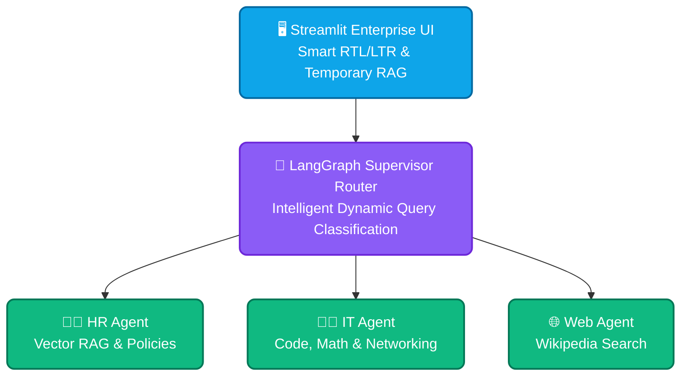

# 🏢 Enterprise Multi-Agent AI System

An advanced, production-ready, local-first multi-agent enterprise framework built with **LangGraph** (Supervisor + Specialized Agents), **Streamlit**, **ChromaDB**, and **Ollama**. Designed for absolu[...]

---

## 🌟 Architecture Overview (100% Local & Secure)

This system is engineered to operate entirely on-premise, ensuring that sensitive corporate data never leaves local infrastructure.



---

## 🏗️ Phase-by-Phase Development Journey

### 1️⃣ Infrastructure & Virtualization Setup
- **Objective:** Isolate the project environment to ensure zero dependency conflicts across servers.
- **Implementation:**
  - Initialized an isolated Python virtual environment (`python3 -m venv .venv`).
  - Structured a clean, scalable directory layout separating agents, tools, and databases (`src/agents/`, `src/tools/`, `src/database/`).
  - Configured resource management via **Docker** and **Ollama**, dedicating hardware resources (CPU/RAM/VRAM) to optimize token generation throughput.

### 2️⃣ Local LLM Engine Integration
- **Objective:** Connect the orchestration layer to an intelligent local decision-making engine.
- **Implementation:**
  - Integrated the stable, high-performance `langchain-ollama` wrapper.
  - Established low-latency communication with **Llama 3.1** running locally on port `11434`.
  - Configured environment-based configuration (`.env`) for flexible deployment across different enterprise server topologies.

### 3️⃣ Enterprise Vector Memory Layer
- **Objective:** Equip the system with proprietary organizational knowledge (internal regulations, corporate structures, and policies).
- **Implementation:**
  - Deployed **ChromaDB** as a local vector store (`chroma_db_storage/`) to maintain data privacy.
  - Utilized the lightweight `nomic-embed-text` model for efficient text-to-vector embedding transformations.

### 4️⃣ Custom Tool Engineering & RAG Architecture
- **Objective:** Give the LLM precise programmatic tools to query internal vector memory and handle dynamic user sessions.
- **Implementation:**
  - Engineered custom tools using LangChain's `@tool` decorator (`knowledge_tool.py`), bypassing restrictive third-party wrappers for absolute control over data flow and prompt formatting.
  - Developed a **Temporary In-Memory RAG** mechanism in Streamlit to instantly parse, chunk (`RecursiveCharacterTextSplitter`), and index user-uploaded PDFs on the fly for lightning-fast session quer[...]

### 5️⃣ Multi-Agent Orchestration (LangGraph Supervisor)
- **Objective:** Coordinate specialized departmental agents under a unified routing manager.
- **Implementation:**
  - Built a Supervisor Router using LangGraph to classify incoming queries and dynamically route them to the appropriate department (`HR`, `IT`, or `Web Research`).
  - Integrated persistent memory (`MemorySaver`) with thread-based isolation for multi-user enterprise chat histories.

---

## 🚀 Quick Start Guide

1. **Clone the repository:**
   ```bash
   git clone https://github.com/Moayadai/enterprise-multi-agent.git
   cd enterprise-multi-agent
   ```

2. **Set up the virtual environment & dependencies:**
   ```bash
   python3 -m venv .venv
   source .venv/bin/activate
   pip install -r requirements.txt
   ```

3. **Configure environment variables:**
   Create a `.env` file in the root directory based on `.env.example`:
   ```env
   OLLAMA_BASE_URL=http://localhost:11434
   ```

4. **Run Ollama & Pull Required Models:**
   ```bash
   ollama run llama3.1
   ollama pull nomic-embed-text
   ```

5. **Launch the Streamlit Enterprise Workspace:**
   ```bash
   streamlit run src/app.py
   ```

---

## 📂 Project Structure

```text
enterprise-multi-agent/
├── src/
│   ├── agents/          # Departmental agents (HR, IT, Web, Supervisor)
│   ├── tools/           # Custom search and utility tools
│   ├── database/        # Vector store & memory handlers
│   └── app.py           # Streamlit enterprise frontend interface
├── .env                 # Environment configuration (ignored by git)
├── .gitignore           # Strict security rules for local DBs & uploads
├── requirements.txt     # Project dependencies
└── README.md            # System documentation
```

---

## 🔒 Security & Privacy (Data Sovereignty)

Designed for high-security environments. All vector embeddings, document parsing, and inference processes occur locally within your containerized infrastructure. No data is sent to external third-p[...]
